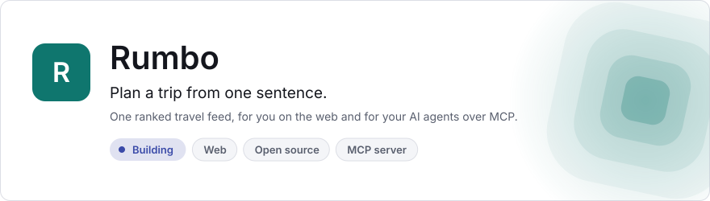
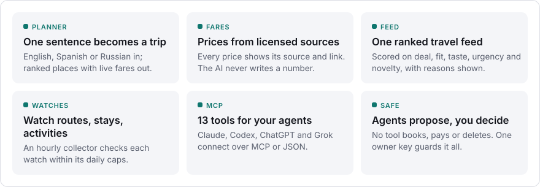
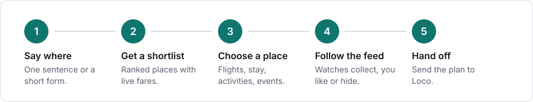

<!-- Pictures: docs/readme/spec.json, drawn by readme-kit. Do not edit the SVGs by hand. -->
<picture><source media="(prefers-color-scheme: dark)" srcset="docs/readme/hero-dark.svg"></picture>

**Destination, flights, stays, car, activities and events in one plan, plus one ranked feed that keeps watching.**

Rumbo is a personal tool for one owner, used on the web and by AI agents over MCP and JSON. It is alpha and in daily use by that owner.

[Getting started](docs/GETTING-STARTED.md) · [Agent setup](#connect-your-ai-agents) · [Docs](#docs)

## What it does

<picture><source media="(prefers-color-scheme: dark)" srcset="docs/readme/highlights-dark.svg"></picture>

- **Planner** (`/plan`). Choosing a place fills flights, stay, activities and events, with links for the car.
- **Feed** (`/`). Each item shows price, source and link, the reasons behind the score, and an optional AI line marked as AI.
- **Feedback.** Like, dislike and hide buttons, plus filters by kind.
- **Agents.** Install scripts and scheduled-run prompts for Claude, Codex, ChatGPT and Grok (`/agents`, `routines/agents/`).
- **Prices.** They come from licensed sources and deep links, never scraping.

Not in yet: booking (by design, D4) and a rental-car source (car is links only).

## How it works

<picture><source media="(prefers-color-scheme: dark)" srcset="docs/readme/steps-dark.svg"></picture>

The collector is `POST /api/v1/collect`. It runs every hour from the scheduler container, calls each due watch's sources within their daily caps, and stores the results.

## Quick start

```bash
cp .env.example .env     # then set RUMBO_OWNER_KEY (openssl rand -hex 24)
./check.sh               # says what is missing; runs types, tests, data checks
npm run dev              # starts Next on port 3000
open http://localhost:3000
# sign in with your RUMBO_OWNER_KEY, then add a watch or fill in /profile
```

Without `RUMBO_OWNER_KEY` the server refuses everything, even on localhost: pages show "Set RUMBO_OWNER_KEY in .env", `/api` answers 503 `not_configured`, and a loud warning prints. Only `GET /api/v1/health` stays open.

| Command | What it does |
|---|---|
| `npm run seed-profile` | Loads a profile from the gitignored `profile.local.yaml` (copy `profile.example.yaml`) |
| `./check.sh usage` | Prints counters from the database: observations, watches, plans, feedback, last collect |

## JSON API

All routes under `/api/v1` need the owner key, except `GET /api/v1/health`. Errors are `{ "error": "code", "detail": ... }`.

| Endpoint | What it does |
|---|---|
| `GET` `PUT` `PATCH /api/v1/profile` | Read or write the profile. `PATCH` merges `{ set, note, agent }` and never deletes |
| `GET /api/v1/feed` | Ranked feed, best first. `?limit &kinds &include_stale` |
| `GET /api/v1/brief` | What a scheduled run should do now. `?agent &connectors` |
| `GET` `POST /api/v1/watches` | List or add watches. `DELETE /api/v1/watches/:id` removes one |
| `GET` `POST /api/v1/observations` | `POST` takes an array, at most 200 per call: `{ accepted, rejected: [{ index, error }] }` |
| `GET` `POST /api/v1/feedback` | Read or send feedback on feed items |
| `GET` `POST /api/v1/history` | Read or import travel history |
| `GET /api/v1/plans` | List plans. `GET /api/v1/plans/:id` reads one; `GET /api/v1/plans/:id/loco` gives the Loco hand-off |

The OpenAPI 3.1 document (for GPT actions and Grok) is public at `/openapi.json`; `/llms.txt` describes the site for agents. Neither holds a secret.

## Connect your AI agents

**Claude Code plugin** (skill and MCP in one step; your own server and owner key):

```
/plugin marketplace add zaitsew/rumbo
/plugin install rumbo@rumbo
```

Claude Code asks for the server URL and the owner key. The key is `sensitive`: it goes to the system keychain, not to a file, and is sent only as a bearer header to that URL.
The plugin registers its own server (tools named `mcp__plugin_rumbo_rumbo__rumbo_*`). Use it or `scripts/install-claude.sh`, not both.

**MCP** speaks Streamable HTTP, stateless, at `/mcp` with `Authorization: Bearer <key>`, and at `/mcp/<key>` for connectors that cannot set a header. Both go through the same lockout and rate limit. A client that can sign in at an authorization server may send an OAuth access token instead; see [docs/MCP-OAUTH.md](docs/MCP-OAUTH.md) (off until `RUMBO_OAUTH_ISSUER` and `RUMBO_OAUTH_OWNER_SUB` are set).

13 tools. None deletes, books or pays.

| Tool | What it does |
|---|---|
| `rumbo_feed` | Read the ranked feed |
| `rumbo_feedback` | Send like, dislike or hide on an item |
| `rumbo_profile_get` / `rumbo_profile_update` | Read or update the profile |
| `rumbo_watch_list` / `rumbo_watch_add` | List or add watches |
| `rumbo_observe` | Report observations an agent found |
| `rumbo_import_history` | Import travel history |
| `rumbo_agent_brief` | What a scheduled run should do now |
| `rumbo_plan_start` / `rumbo_plan_get` / `rumbo_plan_choose` | Start a plan, read it, choose a place |
| `rumbo_to_loco` | Hand a plan off to Loco |

```bash
scripts/install-claude.sh --dry-run && scripts/install-claude.sh   # Claude Code: key in Keychain, MCP server, skill
scripts/install-codex.sh --dry-run && scripts/install-codex.sh     # Codex: same key, bearer_token_env_var
open http://localhost:3000/agents                                   # snippets for every harness, with your host
```

Set `RUMBO_PUBLIC_URL` when the site sits behind a proxy so the snippets show the right address.
Scheduled runs (Claude desktop task, `codex exec` via launchd, ChatGPT and Grok tasks) are in [routines/agents/README.md](routines/agents/README.md).

> [!WARNING]
> The `/mcp/<key>` URL is a secret. Caddy must not log request paths for it: the shipped Caddy fragment has no `log` directive; keep it that way or filter `/mcp/*`.

## Access and security

One key, `RUMBO_OWNER_KEY` (D5). The browser signs in at `/signin` and holds an httpOnly cookie with an HMAC of the key. API clients send `Authorization: Bearer <key>`.
Data lives in SQLite at `RUMBO_DB` (default `./data/rumbo.db`), every row with a `user_id`.

Wrong keys are counted per client address:

- Ten failures in ten minutes lock that address out: 429 for every request, right key included.
- 300 failures from all addresses lock everyone out until the window rolls.

### Which header is trusted

Failures are counted per client address. Production runs behind Caddy on a private Docker network, so the compose file sets `RUMBO_TRUST_PROXY=1`:
Rumbo then reads the **last** entry of `X-Forwarded-For` (the hop Caddy added, which a client cannot choose).
Without that variable no forwarded header is believed and all clients share one bucket, which is the safe setting for a local `next dev`.
`Host` is never used for access decisions.

## What is here

<details>
<summary>Repository layout</summary>

| Path | What |
|---|---|
| `app/` | Next.js App Router: pages, `/api/v1`, `/signin` |
| `src/core/` | Pure TypeScript: the shared schema and, later, ranking and deep links |
| `src/server/` | SQLite store (`node:sqlite`), owner auth, API helpers |
| `scripts/` | `seed-profile`, `usage`, `validate-data`, `deploy.sh`, `install-claude.sh`, `install-codex.sh`, `run-agent.sh` |
| `routines/agents/` | Scheduled-run prompts and setup per harness (Claude, Codex, ChatGPT, Grok) |
| `plugin/` | The Claude Code plugin: manifest and the `rumbo` skill (`skills/rumbo` is a symlink to it) for Claude Code and Codex |
| `deploy/droplet/` | Dockerfile, compose and Caddy fragments for the shared server |
| `docs/` | Brief, architecture, decisions, plan |

</details>

## Deploy

Target: `rumbo.fabriquefutur.com` on the shared droplet (`fabrique-apps-1`), container port **3110** on the internal `apps` network (nothing is published on the host).
The box cannot compile Next, so `scripts/deploy.sh` builds on this machine, ships the standalone output, and builds the image there.
The database sits in a volume at `/srv/rumbo/data`, mounted as `/data` (`RUMBO_DB=/data/rumbo.db`); a deploy never touches it.

```bash
./scripts/deploy.sh --dry     # print every step, run nothing
./scripts/deploy.sh           # build, ship, first run creates the product with add-product.sh
```

On the first run, put `RUMBO_OWNER_KEY` in `/srv/rumbo/.env` on the server and start the container (the script prints the command).
The image needs Node 24 or newer for `node:sqlite`.

## Docs

| Document | What is in it |
|---|---|
| [Getting started](docs/GETTING-STARTED.md) | First run, step by step |
| [Brief](docs/BRIEF.md) | The owner's words |
| [Architecture](docs/ARCHITECTURE.md) | How the parts fit |
| [Decisions](docs/DECISIONS.md) | Numbered decisions (D2, D4, D5 and the rest) |
| [Plan](docs/PLAN.md) | The MVP plan |
| [Sources](docs/SOURCES.md) | Every price source, its cap and terms |
| [Privacy](docs/PRIVACY.md) | Every call that leaves the server |
| [MCP OAuth](docs/MCP-OAUTH.md) | OAuth for `/mcp` |
| [Agent routines](routines/agents/README.md) | Scheduled runs per harness |
| [Plugin](plugin/README.md) | The Claude Code plugin |

## Licence

Apache-2.0, see `LICENSE`.

<sub>Built by <a href="https://github.com/zaitsew">zaitsew</a> with a fleet of AI agents.</sub>
